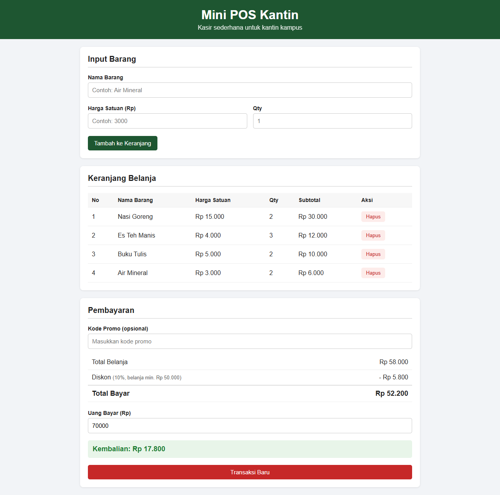
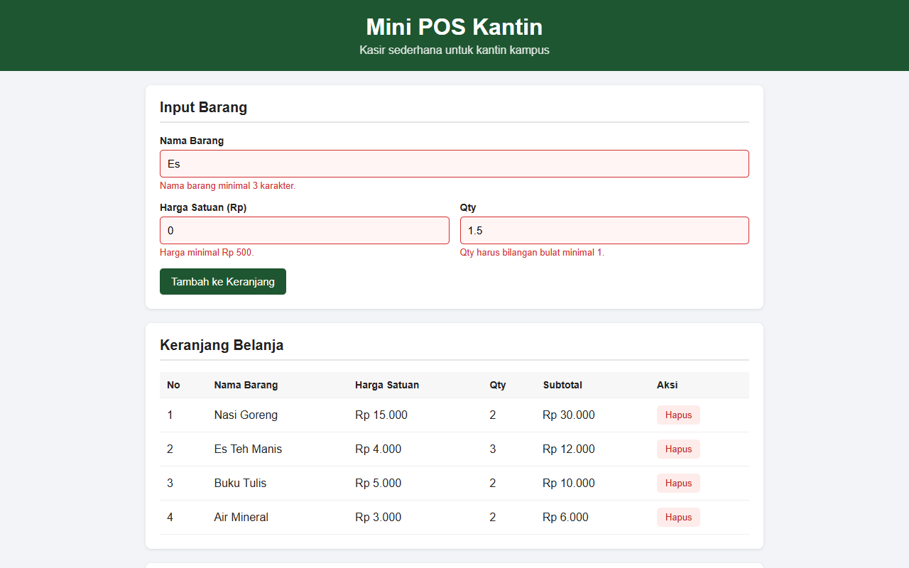
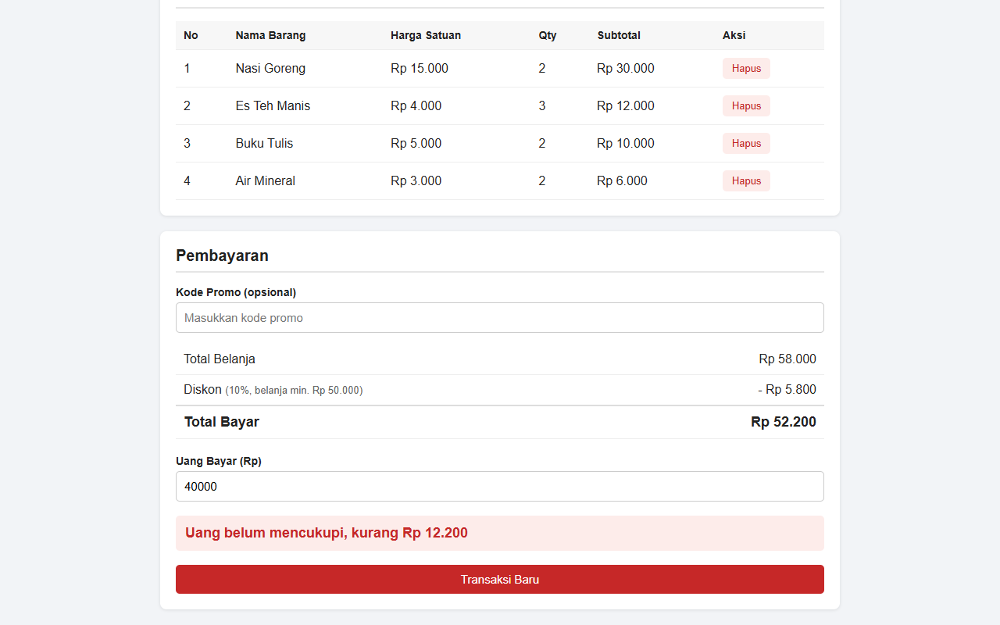
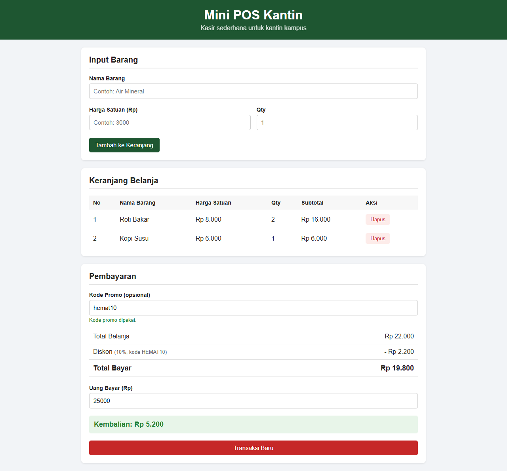

# Mini POS Kantin

Tugas Praktikum Pemrograman Aplikasi Web Pertemuan 1 (JavaScript Dasar)

Nama: Hanung Akbar Pramusintho
NIM: 124140207

## Deskripsi

Aplikasi kasir sederhana untuk kantin atau toko kampus. Kasir bisa memasukkan barang ke keranjang, aplikasi akan menghitung subtotal, total belanja, diskon, dan kembalian secara otomatis. Isi keranjang disimpan di localStorage jadi tidak hilang waktu halaman di-refresh.

## Cara Menjalankan

Tidak perlu install apa-apa. Cukup buka file `index.html` di browser.

## Fitur

1. **Validasi form input barang**
   - Nama barang wajib diisi dan minimal 3 karakter
   - Harga harus angka dan minimal Rp 500
   - Qty harus bilangan bulat minimal 1
   - Kalau ada yang salah, muncul pesan merah di bawah input dan barang tidak masuk ke keranjang. Kalau benar, form langsung di-reset.

2. **Perhitungan otomatis**
   - Subtotal per barang = harga x qty
   - Total belanja = jumlah semua subtotal
   - Diskon 10% kalau total belanja minimal Rp 50.000, atau kalau memasukkan kode promo `HEMAT10`
   - Kembalian = uang bayar - total akhir. Kalau uangnya kurang, muncul keterangan berapa kekurangannya.

3. **Keranjang dan localStorage**
   - Tabel keranjang dengan kolom No, Nama Barang, Harga Satuan, Qty, Subtotal, dan Aksi
   - Tombol Hapus di tiap baris, total dan diskon langsung dihitung ulang
   - Data disimpan dengan `JSON.stringify()` dan dibaca lagi dengan `JSON.parse()`
   - Tombol Transaksi Baru untuk mengosongkan keranjang dan menghapus data di localStorage

## Screenshot

Keranjang belanja dengan diskon otomatis dan kembalian



Validasi form saat input salah



Uang bayar kurang dari total



Diskon pakai kode promo HEMAT10 (total di bawah Rp 50.000)



## Struktur File

```
HanungAkbarPramusintho_124140207_pertemuan1/
├── index.html
├── style.css
├── script.js
└── screenshot/
```
