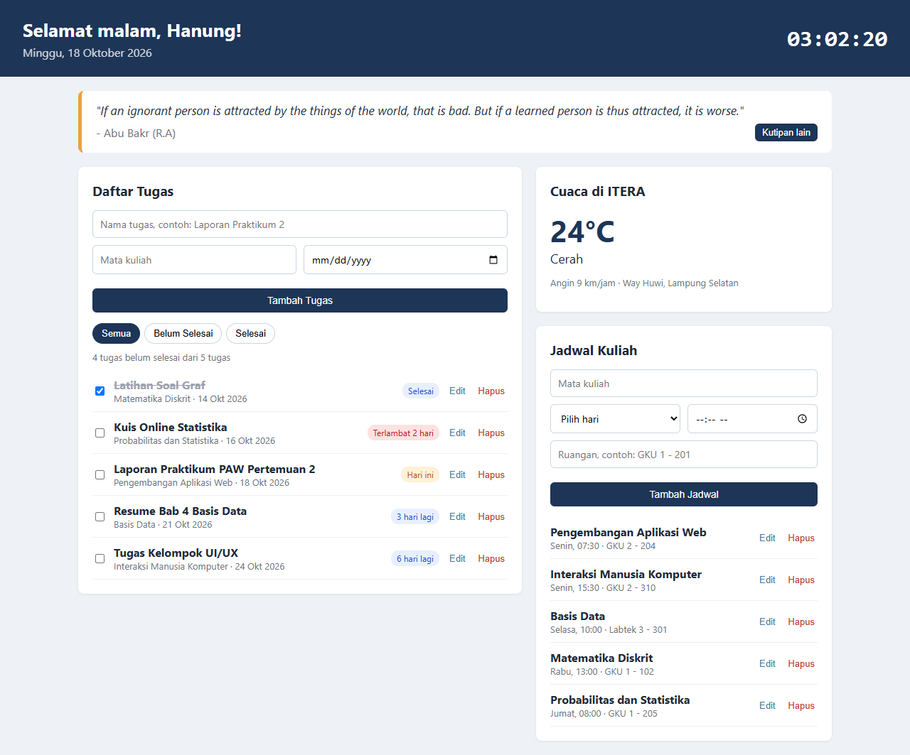
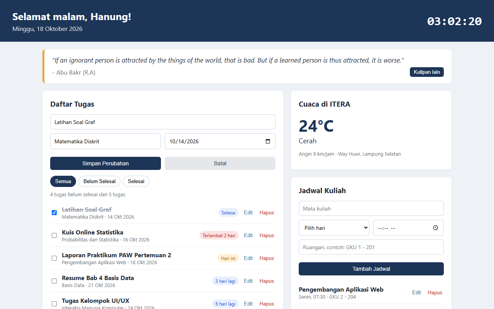
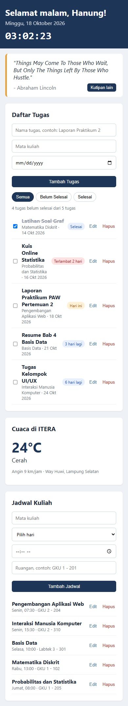

# Dashboard Mahasiswa

Tugas Praktikum Pemrograman Aplikasi Web Pertemuan 2 (JavaScript ES6+)

Nama: Hanung Akbar Pramusintho
NIM: 124140207

## Deskripsi

Dashboard pribadi untuk membantu kegiatan kuliah sehari-hari. Masalah yang sering saya alami itu lupa deadline tugas dan lupa ruangan kuliah, jadi dashboard ini fokus ke dua hal itu. Selain itu ada info cuaca di sekitar kampus ITERA (biar tahu perlu bawa payung atau tidak) dan kutipan motivasi.

## Cara Menjalankan

Buka `index.html` di browser. Butuh koneksi internet untuk data cuaca dan kutipan, fitur lain tetap jalan tanpa internet.

## Fitur

- **Jam dan sapaan**: jam real-time dan sapaan menyesuaikan waktu (pagi/siang/sore/malam)
- **Kutipan harian**: diambil dari API DummyJSON, bisa diganti dengan tombol "Kutipan lain"
- **Cuaca ITERA**: suhu, kondisi, dan kecepatan angin dari API Open-Meteo
- **Daftar tugas**
  - Tambah, edit, dan hapus tugas
  - Centang tugas yang sudah selesai
  - Filter semua / belum selesai / selesai
  - Diurutkan berdasarkan deadline, ada label sisa hari (warna kuning kalau mepet, merah kalau terlambat)
- **Jadwal kuliah**
  - Tambah, edit, dan hapus jadwal
  - Diurutkan berdasarkan hari dan jam
  - Jadwal hari ini diberi tanda
- Semua data tugas dan jadwal disimpan di localStorage

## Screenshot

Tampilan dashboard

Mode edit tugas

Tampilan di HP

## Fitur ES6+ yang Dipakai

Semua kode JavaScript ada di `app.js`.

| Fitur | Baris | Keterangan |
| --- | --- | --- |
| `const` | 1-5, 163-184 | konstanta URL, key localStorage, dan elemen DOM |
| `let` | 117, 200, 374 | variabel yang nilainya berubah (hasil filter, kelas deadline, sapaan) |
| Arrow function | 7, 10, 12, 61, 90, 125, 260, 284, 310 | `formatTanggal`, `duaDigit`, `keteranganCuaca`, callback map/filter/sort, event listener |
| Template literals | 42, 45, 190, 204-215, 230-240, 379 | label deadline, info jumlah tugas, render list tugas dan jadwal |
| Class | 21 (`TaskItem`), 49 (`JadwalItem`), 59 (`DashboardApp`) | model data dan pengelola state aplikasi |
| Destructuring di parameter | 22, 50, 230 | constructor class dan callback `map` jadwal |
| Destructuring objek | 141, 154, 285, 399, 409 | ambil data dari response API dan `dataset` tombol |
| Default parameter | 22, 50 | `id = Date.now()`, `selesai = false` |
| Spread operator | 78, 84, 100, 106, 117, 129 | tambah/ubah data tanpa mengubah array lama (immutable) |
| Async/await + fetch | 135-147, 149-160, 390, 407 | ambil data cuaca dan kutipan, pakai try/catch |
| Method array modern | 61, 90, 95, 125, 198 | `map`, `filter`, `find`, `sort` |

## API yang Dipakai

- Open-Meteo: `https://api.open-meteo.com/v1/forecast?latitude=-5.36&longitude=105.31&current_weather=true`
- DummyJSON Quotes: `https://dummyjson.com/quotes/random`
