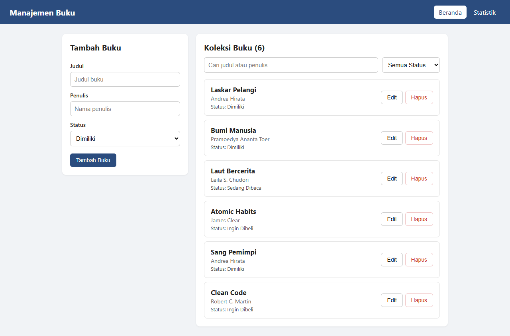
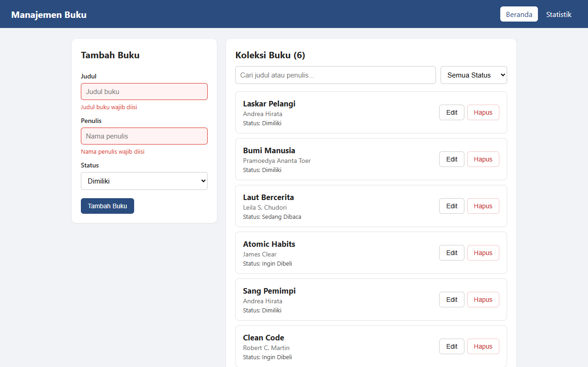
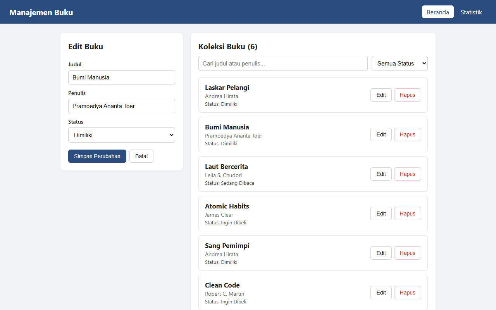
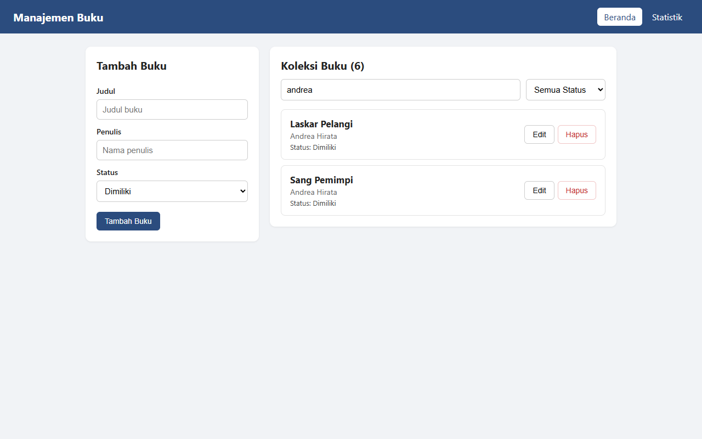
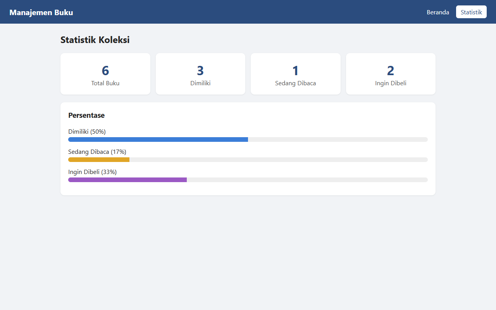
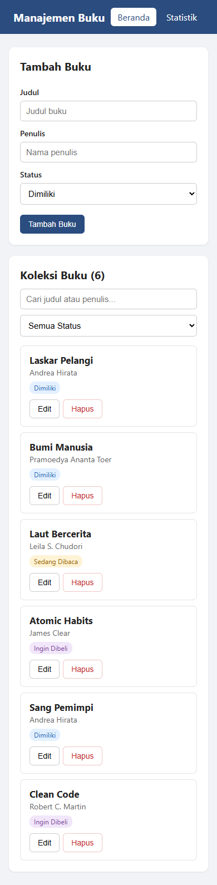
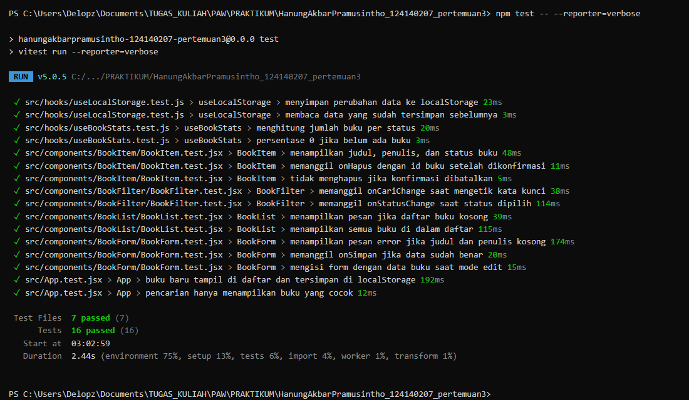

# Manajemen Buku Pribadi

Tugas Praktikum Pemrograman Aplikasi Web Pertemuan 3 (React Basics)

Nama: Hanung Akbar Pramusintho
NIM: 124140207

## Deskripsi

Aplikasi untuk mencatat buku pribadi. Setiap buku punya judul, penulis, dan status:

- **Dimiliki**: buku yang sudah punya
- **Sedang Dibaca**: buku yang lagi dibaca
- **Ingin Dibeli**: buku yang mau dibeli nanti

Data buku disimpan di localStorage, jadi tetap ada walaupun browser ditutup.

## Instalasi dan Cara Menjalankan

```bash
npm install
npm run dev
```

Lalu buka `http://localhost:5173` di browser.

Untuk menjalankan unit test:

```bash
npm test
```

## Fitur

- Tambah buku baru (judul, penulis, status)
- Edit dan hapus buku (hapus ada konfirmasi dulu)
- Filter buku berdasarkan status
- Cari buku berdasarkan judul atau nama penulis
- Halaman statistik jumlah buku per status
- Validasi form: judul dan penulis wajib diisi, kalau kosong input jadi merah dan muncul pesan error

## Screenshot

Halaman beranda



Validasi form kosong



Edit buku



Pencarian "andrea"



Halaman statistik



Tampilan di HP



## Fitur React yang Digunakan

**useState**
Dipakai untuk state form (`judul`, `penulis`, `status`, `error`) di `BookForm.jsx`, dan state pencarian, filter, serta buku yang sedang diedit di `Home.jsx`.

**useEffect**
Di `useLocalStorage.js` untuk menyimpan data ke localStorage setiap kali data berubah. Di `Home.jsx` untuk mengubah judul tab browser sesuai jumlah buku.

**Komponen reusable**
`BookForm` (dipakai untuk tambah dan edit), `BookList`, `BookItem`, `BookFilter`, dan `Navbar`. Semua komponen menerima data lewat props.

**Context API**
`BookContext.jsx` menyimpan `daftarBuku` beserta fungsi `tambahBuku`, `ubahBuku`, dan `hapusBuku`. Halaman Home dan Stats mengambil data dari context lewat hook `useBuku()`, jadi tidak perlu oper props berlapis.

**React Router**
Ada dua halaman: `/` (Beranda) dan `/statistik`. Navigasi pakai `NavLink` di komponen `Navbar`.

**Custom hooks**
- `useLocalStorage`: seperti useState tapi nilainya otomatis disimpan ke localStorage
- `useBookStats`: menghitung total buku, jumlah per status, dan persentasenya

**PropTypes**
Semua komponen yang menerima props punya `propTypes`. Catatan: di React 19 PropTypes sudah tidak dicek otomatis saat runtime, tapi tetap ditulis sebagai dokumentasi tipe props.

## Struktur Folder

```
src/
├── components/
│   ├── BookFilter/
│   ├── BookForm/
│   ├── BookItem/
│   ├── BookList/
│   └── Navbar/
├── context/
│   └── BookContext.jsx
├── hooks/
│   ├── useBookStats.js
│   └── useLocalStorage.js
├── pages/
│   ├── Home/
│   └── Stats/
├── utils/
│   └── status.js
├── App.jsx
├── App.test.jsx
├── main.jsx
└── setupTests.js
```

## Laporan Testing

Testing pakai Vitest dan React Testing Library. Ada 16 test di 7 file:

| File | Yang dites |
| --- | --- |
| `useLocalStorage.test.js` | data tersimpan ke localStorage dan bisa dibaca lagi |
| `useBookStats.test.js` | perhitungan jumlah dan persentase per status |
| `BookForm.test.jsx` | pesan error saat input kosong, submit data valid, mode edit |
| `BookItem.test.jsx` | tampilan data buku, hapus dengan konfirmasi |
| `BookFilter.test.jsx` | input pencarian dan pilihan status |
| `BookList.test.jsx` | pesan daftar kosong dan jumlah item |
| `App.test.jsx` | tambah buku sampai tersimpan di localStorage, pencarian |

Hasil `npm test`:


